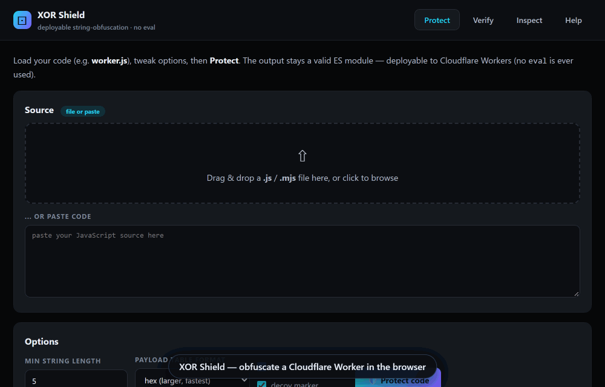

# XOR Shield — deployable XOR obfuscator (single-file webapp)

**Live demo:** <https://farazjz.github.io/xor-shield/> · Licensed MIT

*Drag in a Cloudflare Worker (ready-made sample: [`examples/demo-worker.js`](examples/demo-worker.js)) → a fresh key XOR-packs every string into one table → the round-trip check proves byte-identical output → download the protected file.*

`index.html` is the entire app: open it directly in any modern browser
(double-click — no server, no internet needed). Everything runs client-side.

## What it does
Protects ES-module JavaScript (e.g. Cloudflare Worker `worker.js`) by
**XOR-encoding string literals** at build time and restoring them at runtime
via an embedded helper — **without `eval()` / `new Function()`**, which
Cloudflare Workers block. The output stays a valid ES module and can be
deployed as-is.

- **Protect** — drag&drop (or paste) code → auto-generated 32-byte key per
  run → all qualifying string literals are packed into one hex/base64 table
  and replaced with `_<name>(index)` calls. Options: min string length,
  table format, banner + decoy marker.
- **Verify** — the round-trip check (runs automatically after Protect):
  re-parses the protected output, extracts its embedded table + key, decodes
  every record and byte-compares against the originals → PASS/FAIL.
- **Inspect** — decode any file produced by this tool (locates the table and
  embedded key itself) to audit hidden strings or export them as JSON.
- **Help** — in-app docs.

## Tested against `worker.js` (~1.3 MB)
- 3 998 of 7 053 string literals protected (the rest are short strings,
  templates with `${}`, property keys, directives — skipped by design)
- round-trip verify: PASS (all records byte-identical)
- output ~1.62 MB (+28.7%), gzip ≈ 585 KB, cold-start decode ≈ 3 ms
- protected module imports in Node with the same export shape
  (`{ fetch }`), so it is syntactically ready for `wrangler dev` /
  Cloudflare dashboard deploy

Running `node app-src/test.js` also produces `worker.protected.js` next to
the tool (not committed to this repo). If the original `worker.js` is not in
the folder, the test suite generates a synthetic worker-like module instead —
protect your real file in the app to get the real protected worker.

## Honest limitation
The XOR key lives inside the file (there is no `eval` to keep it separate),
so this is **obfuscation, not encryption**: it defeats casual skimming and
bulk copy-paste, not a determined reverse-engineer.

## License
MIT — see [LICENSE](LICENSE). The embedded JavaScript parser is
[acorn](https://github.com/acornjs/acorn) (MIT © Marijn Haverbeke, Ingvar
Stepanyan, and contributors), bundled unmodified from its UMD build.

## Development
- `app-src/` holds the readable sources (`engine.js`, `ui.js`, `ui.html`,
  `style.css`, `template.html`, `acorn.js`) and `build.ps1`.
- Rebuild the single file: `powershell -ExecutionPolicy Bypass -File app-src\build.ps1`
- Run the engine test suite (needs Node ≥ 18): `node app-src\test.js`
  (edge-case corpus + big worker-like round-trip + Node import smoke test;
  falls back to a synthetic source when `worker.js` is absent)
- Run the UI smoke test (jsdom, needs `npm install` once inside `app-src/`):
  `node app-src\ui-test.js` — loads `index.html` in a simulated browser,
  clicks the Protect flow including the empty-source path, Verify tab, and
  Inspect tab, and fails on any uncaught error
- Regenerate the README animation: `node app-src\make-demo-gif.js`
  (dev-only; install its extra deps first: `npm install puppeteer pngjs gifenc`)
